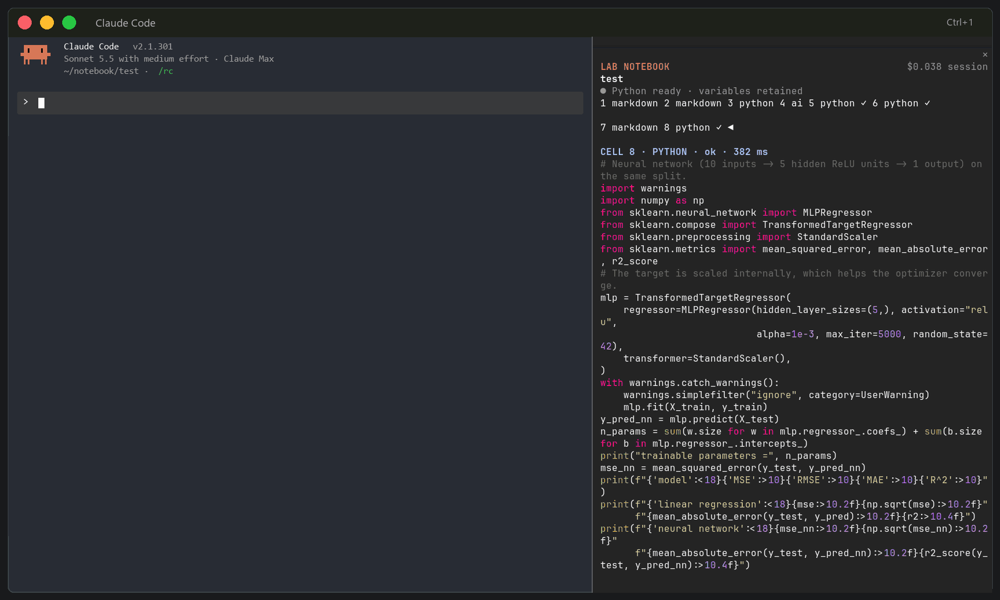

<p align="center">
  
</p>

<h1 align="center">cc-notebook</h1>

A data science lab inside Claude Code.

Claude gets access to your notebook’s cells, live variables, execution status and saved results. When a cell fails, it can inspect, fix and rerun that cell in the same Python session without restarting the whole workflow.

Your edits and cell runs are shared with Claude on your next chat message. Explanations can refer to actual outputs, and experiments stay connected to the conversation.

<p align="center">
  
</p>

## Install and setup

Requires **Python 3.10+** and **Claude Code with function hooks**.

Inside Claude Code:

```text
/plugin install cc-notebook --marketplace AbdoKnbGit/cc-notebook
```

Restart Claude Code, then run:

```text
/lab setup
/lab demo
```

Setup installs the notebook packages and rendering tools automatically.

**Terminal support**

- **Ghostty / Kitty:** native images, LaTeX and diagrams on Linux/macOS. On Windows, run Linux Claude through WSL.
- **iTerm2 3.5+:** native graphics with `/tui fullscreen`.
- **Other terminals:** text and image previews, with links to full images.

Use `/lab graphics` to check your terminal.

## Main commands

Paths are relative to your project folder.

| Command | Action |
|---|---|
| `/lab new note/test2.nb.md` | Create a notebook |
| `/lab open note/test.nb.md` | Open a notebook |
| `/lab import note/test.ipynb` | Import a Jupyter notebook |
| `/lab export ipynb` | Export to Jupyter |

## Features

- Markdown, Python and AI instruction cells in one notebook.
- Persistent Python kernel with variables shared between cells.
- Cell editing, reordering and deletion.
- Execution status, saved outputs and stale-result tracking.
- Run individual cells, restart and run all, interrupt execution and inspect variables.
- Claude can read, edit and run cells through the notebook tool.
- Native inline images on supported terminals, with previews and original-image links elsewhere.
- LaTeX equations, Mermaid diagrams and Typst drawings in the notebook and chat.
- Transparent terminal line charts with readable axes when native images are unavailable.
- Python text, Markdown, LaTeX, PNG, JPEG and SVG outputs shown in execution order.
- Jupyter import/export, including saved outputs and embedded local images.
- Chat visual controls for size, height, themes and text selection/copy.
- Bounded rendering caches, separate from notebook source.
- Bundled data science and drawing skills.

Generated Python waits for you to run it. AI generation uses your Claude model; running Python cells is local.

Use `/iui` for chat visual settings and `/lab doctor` to check dependencies.

## Update

Run in your terminal:

```sh
claude plugin marketplace update cc-notebook
claude plugin update cc-notebook@cc-notebook
```

Restart Claude Code afterward.

[Notebook guide](docs/notebook.md) · [Changelog](CHANGELOG.md)
