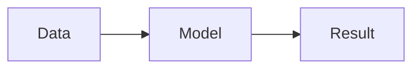

# Notebook guide

Install the plugin using the [README](../README.md#install-and-setup), then run `/lab setup` and `/lab demo`. First setup needs internet access. Python 3.10+ must already be installed; Debian/Ubuntu may also need `python3-venv`.

## Commands

Run these inside Claude Code. Paths are relative to your project folder; `N` is the cell number. Files must stay inside the project.

| Command | Action |
|---|---|
| `/lab` | Open the pane and restore the last notebook |
| `/lab demo` | Create or reopen the visual demo, keeping your edits |
| `/lab new note/test.nb.md` | Create a notebook |
| `/lab open note/test.nb.md` | Open a notebook |
| `/lab import note/test.ipynb` | Import into `note/test.nb.md` |
| `/lab export ipynb [path]` | Export to Jupyter; optionally choose a filename |
| `/lab export markdown [path]` | Export a Markdown report |
| `/lab add <type>` | Add a `markdown`, `python` or `ai` cell |
| `/lab select N` | Select a cell |
| `/lab edit N` | Edit a cell |
| `/lab run N` | Run a Python cell |
| `/lab generate N` | Generate cells from an AI instruction |
| `/lab all` | Restart Python and run all Python cells; stop on error |
| `/lab interrupt` | Stop execution or generation |
| `/lab restart` | Restart Python and clear live variables |
| `/lab vars` | Inspect live variables |
| `/lab refresh` / `/lab status` | Reload notebook state |
| `/lab setup` | Prepare or retry automatic setup |
| `/lab setup repair` | Rebuild the managed environment |
| `/lab python auto` / `/lab python <path>` | Use managed Python or your own executable |
| `/lab doctor` | Check Python and dependencies |
| `/lab graphics` | Check terminal image support |
| `/lab tools` | Check Claude’s notebook connection |

## Cells and editing

- **Markdown:** explanations, equations, local images and diagrams.
- **Python:** code running in a shared local kernel.
- **AI:** instructions that generate 1–8 editable Markdown or Python cells when you choose **Generate cells**.

Click **Edit** or use `/lab edit N`. The editor scrolls with your text and adapts to terminal size. Enter or **Save** saves; use the newline shortcut shown beside the editor, usually Shift+Enter. **Cancel** discards the draft. Save or cancel before switching cells or asking Claude to edit.

Variables persist between cell runs. Switching notebooks, changing Python or restarting Claude clears live variables; saved results remain. Upstream edits and runs mark later results stale. Use **Restart & run all** to check the notebook from a clean state.

## Working with Claude

With a notebook open, ask:

> Change cell 3 to use tau=4, run it, and explain its output.

Claude reads the current notebook, edits the requested cell and runs it in the same kernel. Operation replies show the affected cells. Your next chat message also includes a small snapshot of manual edits and runs; unsaved drafts are excluded.

AI generation uses your session’s model and authentication, with preceding cells, text outputs and a variable summary as context. It consumes model usage. Generated Python waits for an explicit run. Clicking **Run cell** executes locally without a model request. Python runs with your local user’s permissions.

## Visual notebook

Put Markdown and equations in the same Markdown cell. Use `$...$` for inline notation and `$$` on separate lines for a typeset display equation:

````markdown
# Decay experiment

The time constant is $\tau = 2$.

$$
y(t) = A e^{-t/\tau}
$$



````

Image paths are relative to the notebook. For spaces, use ``. Local PNG, JPEG, WebP and GIF images are supported; remote images are not downloaded.

Mermaid supports flowcharts, state, sequence, class and ER diagrams. Use a `typst` or `typ` fence for drawings with CeTZ, fletcher or cetz-plot. Drawings fit the pane and keep editable source. Metric/formula tables display as labels with separate equations.

Display math also accepts `\[...\]` and `latex` or `math` fences. Use equation fragments rather than full LaTeX documents. Unsupported expressions keep their source and an error. In the editor, seeing the original syntax is expected.

Native images work in Ghostty/Kitty on Linux/macOS, including Linux Claude in WSL. iTerm2 3.5+ requires `/tui fullscreen` and `CLAUDE_CODE_ALT_SCREEN_FULL_REPAINT` unset. Other terminals use text or image previews and links to originals. tmux/screen do not pass native graphics through Claude Code.

Simple Matplotlib line charts get readable terminal curves when native images are unavailable. HTML, JavaScript widgets and interactive Plotly output are not rendered; display a PNG instead.

Chat visuals use `/iui on` or `/iui off`. Set text size with `/iui size 100`, drawing height with `/iui height half`, and themes with `/iui theme`. `/iui details` shows the current renderer settings.

## Python environments

Automatic setup keeps its environment outside your project and reuses it across plugin updates. To use your own environment, install the [notebook requirements](../notebook/requirements.txt) there and select its Python executable:

```text
/lab python /home/ok/my-env/bin/python
/lab doctor
```

In WSL, choose a Python environment created inside WSL. `/lab python auto` returns to the managed environment. Switching environments stops the kernel.

## Import and export

The plugin saves notebooks as `.nb.md`. Import creates this format from `.ipynb` without running cells or restoring old outputs. Export includes valid saved outputs and local images; AI instructions are preserved as labeled Markdown with metadata.

New notebooks and exports never overwrite existing files. Choose another export filename when needed:

```text
/lab export ipynb note/results-v2.ipynb
```

Use `.ipynb` for a portable notebook with embedded images. Markdown reports link to local image files.

## Troubleshooting

- **Missing packages or failed downloads:** `/lab setup`; use `/lab setup repair` for a damaged managed environment.
- **Claude cannot access cells:** open the notebook, then `/lab tools`. Tools use a bundled stdio connection; no HTTP port or token needs configuring. Python 3.10+ must be on PATH. If discovery fails, a fallback connects to the same kernel. Restart Claude or use `/reload-plugins` to retry.
- **Missing images or raw LaTeX:** `/lab graphics`; check math delimiters and close code fences. Use **Open original image** for full detail.
- **Changed files or old previews:** save/cancel any draft, then `/lab refresh`.

Generated previews and outputs live under `.claude-notebook/` in bounded caches. Notebook source is separate. Export results you want to keep.

## Development

Launch Claude with the plugin once to generate hook types, then run:

```sh
npm ci
npm run build
npm test
npm run test:plugin
npm run test:visuals
npm run validate
```

Visual tests use Typst from `/lab setup`. Automated tests do not require paid model requests.

After changing `mcp/`, rebuild its checked-in bundle with `npm run build:mcp`. To test real tool discovery and shared kernel state in an isolated Claude session, run `python scripts/test_mcp_host.py --python <notebook-python>`.

Rendering is adapted from [Intelligent UI](https://github.com/razorback16/cc-intelligent-ui), with image transport ideas from [show-your-work](https://github.com/iamumeransari/claude-show-your-work). See [third-party notices](../THIRD_PARTY_NOTICES.md).
