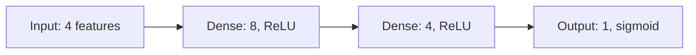

# Data science in the conversation and notebook

Answer with the requested diagram, equation, plot, or explanation directly in the conversation. The plugin renders Markdown images, LaTeX, Mermaid, and Typst there. An active notebook also renders Mermaid and Typst/CeTZ code fences in Markdown cells and rich outputs. Opening the notebook panel alone does not fulfill a request to show a drawing in chat.

## Connect to the notebook

- Read the current notebook context supplied by the plugin. If a notebook is active, call its listed notebook tool (normally `mcp__plugin_cc-notebook_notebook__notebook`) with `action: "status"` before changing cells or interpreting results. It returns cell IDs, sources, revision, kernel status and saved outputs. Use the CLI bridge described in that context if the native tool is unavailable; do not guess a runtime path or use a separate Python process as its kernel.
- For an active notebook, save a new requested diagram or analysis as a Markdown cell, or update the cell the user names. Keep the editable Mermaid/Typst/LaTeX source, not just a screenshot. Pass the current revision; use the new revision returned by each mutation. If the notebook changed, refresh before retrying. Explain which cell holds the drawing in one short sentence and show the same source in the answer.
- When asked only to explain an existing result, read it and answer without adding duplicate cells. Refer to the cell number/ID and distinguish saved output from currently live variables. Do not replay other cells' outputs. Existing Python plots can be shown with ``.
- A generic neural network sketch is illustrative unless its architecture comes from the actual model code. Never infer trained weights, accuracy, data provenance, or successful execution from a diagram. If the model is available, label its actual layer sizes and activations.
- Add/update Python through the notebook tool and run it there when execution is requested. Variables then remain in the same kernel. Editing or drawing never implies that Python has run. Follow session permissions for execution. AI cells hold generation instructions; they are not executed Python.
- Without an active notebook, show the drawing in chat. Create a notebook when requested. Do not require a notebook for a standalone explanation.

## Choose the visual

| Need | Representation |
|---|---|
| Model architecture, preprocessing pipeline, state flow | A fenced `mermaid` graph, usually `graph LR` |
| Neurons, weighted edges, custom geometry, fractals | A fenced `typst` block using CeTZ |
| Labelled diagrams or commutative diagrams | Typst with fletcher |
| Function curves or small declarative charts | Typst with cetz-plot |
| Analysis of real data or an existing experiment | Python in the notebook; display its saved image in chat |
| Mathematical explanation | `$…$` within prose and `$$…$$` for a separate typeset equation |

For complex Typst drawings, load `cc-notebook:intelligent-ui` (also at [../intelligent-ui/SKILL.md](../intelligent-ui/SKILL.md)). Its local package references and compile checker cover CeTZ, cetz-plot, fletcher, candlesticks, heatmaps and Typst computation. Use theme colours and fit `theme.width` and `theme.height`. Read the resulting preview before presenting an intricate drawing.

Mermaid supports flowcharts, state, sequence, class and ER diagrams through the bundled renderer. Use short labels, modest graphs, and complete top-level fences. Unsupported syntax stays visible as source; simplify it or use a tested Typst block. Do not install a browser or fetch a remote rendering service.

Example illustrative architecture (replace dimensions with the real model when available):

Keep datasets and calculation outputs in notebook cells. Label synthetic data and assumptions. Show uncertainty, units, train/test boundaries and metric definitions when relevant. A rendered plot is a view of the saved computation, not a substitute for it. For several equations (such as Maxwell's), use separate display blocks or an aligned multi-line block so they remain readable on a narrow terminal.
