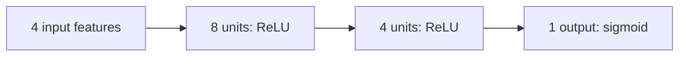

## An illustrative neural network

Four features enter two hidden layers. The output is a probability; this drawing does not imply that a model has been trained.



$$\hat{y} = \sigma\left(W_3\,\mathrm{ReLU}\left(W_2\,\mathrm{ReLU}(W_1x+b_1)+b_2\right)+b_3\right)$$

The editable diagram belongs with its model definition in a Markdown notebook cell.

```typst
#import "@preview/cetz:0.5.2"
#cetz.canvas(length: calc.min(theme.width / 12, theme.height / 5), {
  import cetz.draw: *
  set-style(stroke: theme.muted)
  let layers = ((0.5, 1.5, 2.5), (0, 1, 2, 3), (1, 2))
  for layer in range(2) {
    for a in layers.at(layer) {
      for b in layers.at(layer + 1) {
        line((layer * 4, a), ((layer + 1) * 4, b), stroke: theme.border)
      }
    }
  }
  for (layer, ys) in layers.enumerate() {
    for y in ys {
      circle((layer * 4, y), radius: 0.25, fill: theme.palette.at(layer), stroke: theme.fg)
    }
  }
  for (x, label) in ((0, [Input]), (4, [Hidden]), (8, [Output])) {
    content((x, -0.8), label)
  }
})
```
